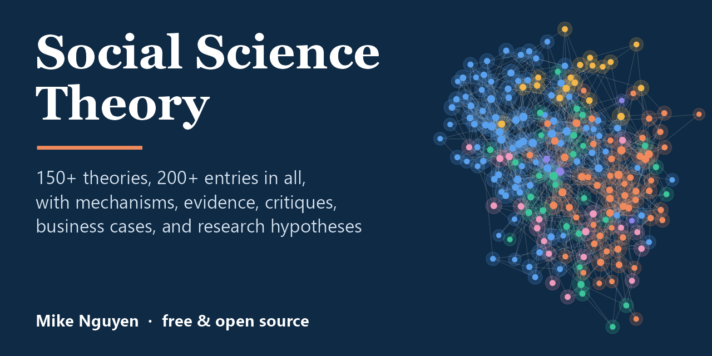

<p align="center">
  <a href="https://mikenguyen13.github.io/social-theory"></a>
</p>

<h1 align="center">Social Science Theory</h1>

<p align="center">
  <b>A free, open-source field guide to the theories, effects, and frameworks behind research and business.</b><br>
  150+ theories · 200+ entries · mechanism diagrams · evidence & critiques · business cases · ready-to-use hypotheses
</p>

<p align="center">
  <a href="https://mikenguyen13.github.io/social-theory"></a>
  <a href="https://github.com/mikenguyen13/social-theory/stargazers"></a>
  <a href="https://github.com/mikenguyen13/social-theory/actions/workflows/book.yml"></a>
  <a href="https://doi.org/10.5281/zenodo.23708720"></a>
  <a href="LICENSE"></a>
  <a href="CONTRIBUTING.md"></a>
</p>

---

Every field has theories its members "just know", **signaling**, **agency**,
**the resource-based view**, **prospect theory**, **social identity**,
**diffusion of innovations**, and newcomers are expected to absorb them one paper
at a time. This book puts them in one place, in one consistent format, with the
depth researchers need and the examples practitioners want.

> **Read it online:** **[mikenguyen13.github.io/social-theory](https://mikenguyen13.github.io/social-theory/)**  
> Mirror: [Posit Connect Cloud](https://mike-social-theory.share.connect.posit.cloud/)

## Why this book

- **Systematic.** Each theory gets a *theory card* (core claim, origins, level of
  analysis, constructs, boundary conditions, related theories) so you can compare
  theories at a glance.
- **Rigorous.** Core logic and propositions, mechanism diagrams, empirical
  evidence, critiques, and replication status: with references to the original
  sources.
- **Practical.** Business cases across strategy, marketing, finance, HR,
  operations, and policy show where each theory earns its keep.
- **Research-ready.** Every major theory includes a *research toolkit*: sample
  hypotheses, operationalizations, designs, and data sources.
- **Visual and reproducible.** 450+ figures and diagrams, all generated from R code
  in this repository, plus an interactive theory map and a searchable
  [Theory Atlas](data/theory-atlas.csv).

## What's inside

| Part | Chapters |
|---|---|
| **Foundations** | 1 Introduction · 2 What Is a Theory? · 3 Using Theory in Research and Practice |
| **Organizations & Strategy** | 4 Resources and Competitive Advantage (RBV, VRIO, KBV) · 5 Dynamic Capabilities, Learning, and Renewal · 6 Governance, Contracts, and Leadership (agency, stewardship, TCE, upper echelons) · 7 Organizations and Their Environments (resource dependence, institutional, stakeholder, CSR) · 8 Information, Signals, and Markets · 9 Social Exchange and Networks · 10 Innovation Diffusion and Technology Adoption · 11 Strategy, Competition, and Industries · 12 Innovation and Entrepreneurship · 13 International Business · 14 Organizations, Teams, and Decision Processes · 15 Work, Jobs, and Leadership |
| **Markets, Finance & Economics** | 16 Finance and Corporate Policy (portfolio theory, CAPM, efficient markets, Modigliani-Miller, behavioral finance) · 17 Economics of Markets and Institutions (Coase, collective action, network effects, two-sided markets, auctions, social preferences) |
| **Individuals & Groups** | 18 Culture · 19 Motivation · 20 Self-Regulation and Construal · 21 Attitudes, Attribution, and Social Learning · 22 Social Comparison, Identity, and Influence · 23 Judgment and Decision Making · 24 Prospect Theory and Reference-Dependent Preferences · 25 Emotion and Well-Being · 26 Persuasion and Communication |
| **Consumers & Marketing** | 27 Consumer Behavior and Branding · 28 Marketing Strategy and Services |
| **Effects, Phenomena & Frameworks** | 29 Named Effects (mere exposure, decoy, IKEA, glass cliff) · 30 Social Phenomena (wisdom of crowds, Matthew effect, groupthink, bullwhip) · 31 Models and Frameworks · 32 Theory Atlas and Glossary |

## A taste: the theory card

> **Signaling theory**
> **Core claim.** An informed party can credibly convey unobservable quality by taking a costly, observable action that low-quality types would find too expensive to imitate.
> **Origins.** Spence (1973), *Quarterly Journal of Economics*.
> **Level of analysis.** Dyad and market.
> **Boundary conditions.** Quality is unobservable ex ante. Signal cost is negatively correlated with quality. Receivers can observe and interpret the signal.
> **Business use.** Warranties, credentials, IPO underwriters, verified-seller badges.

## Who it's for

- **PhD students** looking for a map of the theoretical landscape and a fast way
  to find the right lens for a research question.
- **Faculty** who want a free, citable companion text for seminars in management,
  marketing, organizational behaviour, consumer behaviour, and economic sociology.
- **Practitioners**, strategists, marketers, product managers, analysts, HR
  leaders, consultants, who want to know *why* an intervention works and when it
  will stop working.

## Build the book locally

Requirements: R (≥ 4.2) and the packages below. Pandoc ships with RStudio/Positron
or Quarto.

```r
install.packages(c("bookdown", "rmarkdown", "knitr", "ggplot2", "dplyr", "tidyr",
                   "kableExtra", "DiagrammeR", "visNetwork", "DT", "igraph", "ggraph",
                   "readr", "tibble", "scales", "patchwork", "ggrepel", "yaml",
                   "bslib", "downlit", "xml2", "ragg"))
source("tools/merge_bib.R")                        # merge bib/*.bib -> references.bib
bookdown::render_book("index.Rmd", "bookdown::bs4_book")
```

The site is written to `docs/`. Check a single chapter quickly with
`Rscript tools/check_chapter.R 08-information.Rmd`.

## Cite this book

```bibtex
Nguyen, M. (2026). *Social Science Theory: A Field Guide to the Theories,
Effects, and Frameworks Behind Research and Business*. Zenodo.
https://doi.org/10.5281/zenodo.23708720

```bibtex
@book{nguyen_social_theory,
  author    = {Nguyen, Mike},
  title     = {Social Science Theory: A Field Guide to the Theories, Effects,
               and Frameworks Behind Research and Business},
  year      = {2026},
  publisher = {Zenodo},
  doi       = {10.5281/zenodo.23708720},
  url       = {https://mikenguyen13.github.io/social-theory/}
}
```

The DOI always resolves to the latest edition. Each release archived on
Zenodo also has its own version DOI. GitHub's **"Cite this repository"**
button (from [`CITATION.cff`](CITATION.cff)) gives APA and BibTeX formats.

## Contribute

Found an error? Want to add a theory, a better business example, or a
translation? Contributions are very welcome: see
[CONTRIBUTING.md](CONTRIBUTING.md) and the [style guide](STYLE_GUIDE.md), or
[suggest a theory](https://github.com/mikenguyen13/social-theory/issues/new/choose).

If this book helps you, **please ⭐ the repository**: it is the simplest way to
help other students and researchers find it.

## License

- **Book text, figures, and tables:** [Creative Commons Attribution 4.0 International (CC BY 4.0)](https://creativecommons.org/licenses/by/4.0/).
  You may share and adapt the material for any purpose, including commercially,
  as long as you give appropriate credit, link to the license, and indicate if
  changes were made. Full text in [`LICENSE`](LICENSE).
- **Code** (R scripts in `tools/`, `_common.R`, and the code chunks that build
  figures and tables): [MIT License](LICENSE-CODE).

Suggested attribution: *Nguyen, M. Social Science Theory: A Field Guide to the
Theories, Effects, and Frameworks Behind Research and Business.
https://mikenguyen13.github.io/social-theory/, licensed under CC BY 4.0.*

## Related

- *A Guide on Data Analysis*: the author's companion book on statistics, causal
  inference, and research methods.
